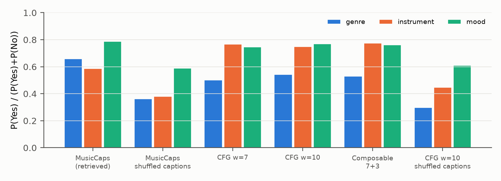
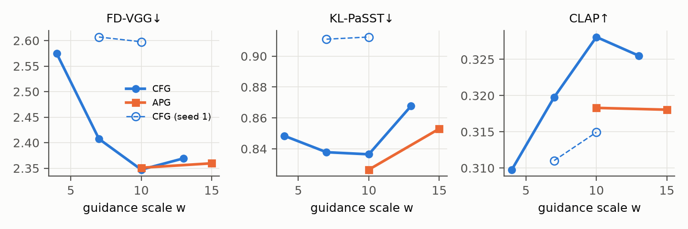
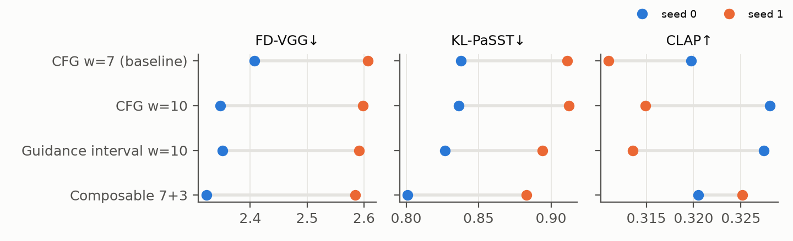
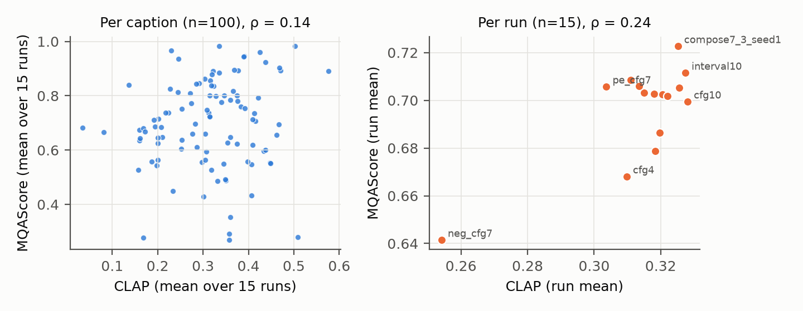

# HW3 — Text-to-Music with Stable Audio Open: Retrieval, CFG, Evaluation and Improvements

All numbers in this report are produced by `sample_code/analyze.py` (→ `report/tables.md`, `report/figs/`).
Generation: Stable Audio Open 1.0, 100 DPM-Solver steps, 10 s, seed 0 unless stated, 100 test captions.

---

## 1. CLAP retrieval (MusicCaps)

* Model: LAION-CLAP `music_audioset_epoch_15_esc_90.14.pt` (HTSAT-base, music checkpoint).
* Every MusicCaps clip is embedded once (48 kHz, first 10 s) and cached (`musiccaps_clap_emb.npz`);
  each test caption is embedded with the text tower; retrieval = argmax cosine similarity.
* Output: `retrieval/retrieval.csv` (top-1 YouTube id + score, plus top-5) and `retrieval/audio/{id}_{ytid}.mp3`.

| | value |
|---|---|
| mean top-1 CLAP similarity | **0.461** |
| min / max | 0.355 / 0.589 |
| distinct clips retrieved | 69 / 100 |

The retrieved clips serve as the **reference set** for FAD/KL (`eval/gt/{id}.wav`, paired by caption id).

## 2. Classifier-free guidance (`sample_code/cfg.py`)

```python
return noise_pred_uncond + guidance_scale * (noise_pred_cond - noise_pred_uncond)
```

`python cfg.py --check` reproduces the diffusers pipeline's built-in CFG exactly (max abs diff 0.0).

## 3. Evaluation setup

av-benchmark (hkchengrex) with the reference set above, 10 s audio:
**FD-VGG** (= FAD), FD-PANN, FD-PaSST, **KL-PANNs / KL-PaSST** (paired, softmax), **LAION-CLAP** text-audio score
(the music CLAP checkpoint above). Lower is better for FD/KL, higher for CLAP.

Patches needed to run it on Windows / current libraries (all local, documented in `hw3-setup` notes):
CLAP checkpoint switched to the music model; video models (ImageBind/Synchformer) loaded only when video metrics
are requested; `torchaudio.load` replaced by a soundfile loader (torchaudio ≥2.9 silently skipped every file);
`torch.hub(..., trust_repo=True)`; msclap tokenizer call updated for transformers 5.

## 4. MQAScore — how it is implemented (`sample_code/mqascore.py`)

CLAP gives one global similarity and is known to be weak on compositional captions. MQAScore (inspired by
VQAScore/AQAScore) instead asks an **audio-language model** about each atomic concept of the caption.

1. **Concept decomposition.** Each caption is split into *genre*, *instruments* (list) and *mood* (list)
   → `sample_code/concepts.csv` (e.g. id 3: genre = `jazz`, instruments = `piano; double bass; drums`,
   mood = `relaxed; smooth`).
2. **Judge.** Qwen2-Audio-7B-Instruct (4-bit NF4, fits the 8 GB GPU). For each concept one yes/no question, e.g.
   *"Is piano clearly audible in this recording? Answer 'Yes' only if you are confident, otherwise answer 'No'."*
3. **Score = calibrated confidence, not the generated text:**
   s(c) = P(Yes) / (P(Yes) + P(No)) from the next-token distribution (case variants summed).
   MQAScore(clip) = mean over concepts; we also report per-category means and a *global* question with the full caption.
4. **Prompt template chosen by a validation probe** (`mqa_probe.py`): 12 reference clips scored with their own
   caption vs. a mismatched caption, for three templates. The naive template has a strong yes-bias
   (mismatched captions still get 0.74). The "strict" suffix removes most of it and separates best:

   | template | AUC match vs mismatch | mean (match) | mean (mismatch) |
   |---|---|---|---|
   | plain | 0.674 | 0.924 | 0.741 |
   | **strict (used)** | **0.697** | 0.670 | 0.430 |
   | describe | 0.672 | 0.892 | 0.698 |

5. **Sanity control (full 100 clips):** score each clip against a *different* caption (`--shuffle`, fixed offset 50).

   | audio | MQAScore matched | MQAScore shuffled | AUC | clips where matched > shuffled |
   |---|---|---|---|---|
   | MusicCaps reference | 0.682 | 0.454 | 0.761 | 78 % |
   | CFG w=10 generations | 0.699 | 0.472 | 0.771 | 79 % |

   So the metric clearly responds to text-audio agreement. The global full-caption question is weaker
   (it saturates at ≈0.9 for all systems), which supports the concept-level design.



**Observation.** Generated audio scores *higher* than the real MusicCaps references on instruments
(0.75–0.78 vs 0.59) but lower on genre (0.50–0.57 vs 0.66). The retrieved references are only approximate
matches (CLAP 0.46) and real YouTube recordings are mixed/noisy, whereas the generator renders the requested
instruments very literally but captures genre less convincingly.

## 5. Methods tried to improve generation

| tag | method | idea |
|---|---|---|
| `cfg{4,7,10,13}` | CFG scale sweep | baseline is w = 7 |
| `apg{10,15}` | **APG** (Adaptive Projected Guidance, Sadat et al., ICLR'25) | in x₀-space, drop the guidance component parallel to the conditional prediction (η=0) + momentum −0.5 → allows higher w without over-saturation. Stable Audio is v-prediction with an EDM-style scheduler, so x₀ = c_skip·x + c_out·v with σ_data = 1. |
| `interval10` | **Guidance interval** (Kynkäänniemi et al., NeurIPS'24) | apply CFG (w=10) only when σ ≤ 50; at the highest-noise steps use the plain conditional output |
| `compose7_3` | **Composable / concept guidance** (Liu et al., ECCV'22) | v = v_u + w(v_c − v_u) + (λ/K)·Σₖ(v_k − v_u), with K=3 concept prompts from `concepts.csv` ("{genre} music", instrument list, "{mood} mood"); w=7, λ=3 |
| `pe_cfg7` | prompt engineering | captions rewritten into tag style (`prompts_rewritten.csv`) |
| `neg_cfg7` | negative prompt | "low quality, noise, distortion, …" replaces the empty unconditional prompt |
| `cfg10_50steps` | fewer steps | 50 instead of 100 sampling steps |
| `*_seed1` | seed replicate | same setting, seed 1, to measure noise |

## 6. Results

### 6.1 All runs (seed 0 unless noted)

| run | FD-VGG↓ | FD-PANN↓ | FD-PaSST↓ | KL-PANNs↓ | KL-PaSST↓ | CLAP↑ | MQAScore↑ |
|:--|--:|--:|--:|--:|--:|--:|--:|
| cfg4 | 2.575 | 46.04 | 730.2 | 1.268 | 0.848 | 0.310 | 0.668 |
| **cfg7 (baseline)** | 2.407 | 45.03 | 706.1 | 1.176 | 0.838 | 0.320 | 0.687 |
| cfg10 | 2.347 | 43.45 | 709.2 | 1.166 | 0.836 | **0.328** | 0.699 |
| cfg13 | 2.369 | 43.39 | 726.2 | 1.176 | 0.868 | 0.326 | 0.705 |
| apg10 | 2.351 | 45.15 | 710.0 | 1.179 | 0.827 | 0.318 | 0.679 |
| apg15 | 2.360 | 44.40 | 719.4 | **1.145** | 0.853 | 0.318 | 0.703 |
| interval10 | 2.351 | **43.27** | 713.3 | 1.157 | 0.827 | 0.327 | **0.712** |
| compose7_3 | **2.323** | 43.92 | 706.3 | 1.176 | **0.801** | 0.320 | 0.702 |
| pe_cfg7 | 3.036 | 48.65 | 798.3 | 1.385 | 1.057 | 0.304 | 0.706 |
| neg_cfg7 | 3.706 | 47.20 | 824.9 | 1.355 | 1.067 | 0.254 | 0.642 |
| cfg10_50steps | 2.437 | 43.32 | 714.5 | 1.232 | 0.874 | 0.322 | 0.702 |
| cfg7_seed1 | 2.607 | 46.12 | 727.6 | 1.185 | 0.911 | 0.311 | 0.709 |
| cfg10_seed1 | 2.598 | 44.17 | 725.5 | 1.195 | 0.912 | 0.315 | 0.703 |
| interval10_seed1 | 2.591 | 45.03 | 722.3 | 1.176 | 0.894 | 0.314 | 0.706 |
| compose7_3_seed1 | 2.584 | 44.96 | 727.8 | 1.199 | 0.883 | 0.325 | 0.723 |

### 6.2 Ablation: guidance scale



* Raising w from 4 → 10 improves every metric (FD-VGG 2.57 → 2.35, CLAP 0.310 → 0.328); w = 13 starts to hurt
  KL-PaSST and FD-PaSST (over-guidance) → **w ≈ 10 is the sweet spot**.
* APG keeps FD flat from w = 10 to 15 (its purpose: less over-saturation at high w) and gives the best KL-PANNs at
  w = 15, but does not raise CLAP; the projection removes part of the text-driving signal.
* **Seed effect is as large as the scale effect.** The hollow seed-1 points sit 0.2 FD-VGG / 0.07 KL-PaSST above
  their seed-0 counterparts — larger than the gap between any two guidance methods.

### 6.3 Ablation: methods across two seeds



Two-seed mean ± half-range:

| run | FD-VGG↓ | FD-PANN↓ | KL-PaSST↓ | CLAP↑ | MQAScore↑ |
|:--|--|--|--|--|--|
| cfg7 (baseline) | 2.507 ± 0.100 | 45.57 ± 0.55 | 0.874 ± 0.037 | 0.315 ± 0.004 | 0.698 ± 0.011 |
| cfg10 | 2.472 ± 0.125 | **43.81 ± 0.36** | 0.874 ± 0.038 | 0.322 ± 0.007 | 0.701 ± 0.002 |
| interval10 | 2.471 ± 0.120 | 44.15 ± 0.88 | 0.860 ± 0.034 | 0.320 ± 0.007 | 0.709 ± 0.003 |
| **compose7_3** | **2.454 ± 0.131** | 44.44 ± 0.52 | **0.842 ± 0.041** | **0.323 ± 0.002** | **0.713 ± 0.010** |

Composable concept guidance is the only method that is better than the baseline on **both** seeds for
FD-VGG, KL-PaSST, CLAP and MQAScore, and it has the most stable CLAP across seeds.

### 6.4 Statistical significance (paired bootstrap over the 100 captions, 10 000 resamples, same seed)

| run vs baseline (same seed) | ΔCLAP [95 % CI] | ΔMQAScore [95 % CI] |
|---|---|---|
| cfg4 | −0.010 [−0.020, −0.000] ✱ | −0.018 [−0.045, 0.007] |
| cfg10 | +0.008 [−0.004, 0.022] | +0.013 [−0.010, 0.035] |
| apg15 | −0.002 [−0.013, 0.010] | +0.016 [−0.008, 0.040] |
| interval10 | +0.008 [−0.004, 0.019] | **+0.025 [0.005, 0.046] ✱** |
| compose7_3 (seed 0) | +0.001 [−0.008, 0.010] | +0.016 [−0.005, 0.038] |
| compose7_3 (seed 1) | **+0.014 [0.004, 0.025] ✱** | +0.014 [−0.005, 0.035] |
| pe_cfg7 | −0.016 [−0.038, 0.005] | +0.019 [−0.015, 0.054] |
| neg_cfg7 | **−0.066 [−0.085, −0.046] ✱** | **−0.045 [−0.082, −0.009] ✱** |

✱ = 95 % CI excludes 0. (FD/KL are distribution-level metrics and cannot be bootstrapped per clip in the same way.)

## 7. Discussion

* **What helped:** a higher guidance scale (w ≈ 10) and the guidance variants built on it. Composable concept
  guidance gives the most consistent gains (best two-seed mean on FD-VGG, KL-PaSST, CLAP, MQAScore; significant
  CLAP gain on seed 1). The guidance interval gives the largest per-clip MQAScore gain on seed 0 (significant).
  However, all of these gains are *small compared with seed-to-seed variation* of the distribution metrics,
  so they should be read as trends, not definitive wins.
* **What hurt:** the negative prompt is clearly worse on every metric — Stable Audio Open was trained with an
  empty unconditional prompt, so replacing it moves the guidance direction away from the training distribution.
  Tag-style prompt rewriting raises genre accuracy in MQAScore (0.63 vs 0.50) but worsens FD/KL and CLAP: the
  rewritten prompts drift from MusicCaps-style captions that the reference set and CLAP are tied to.
* **Steps:** 50 steps is about as good as 100 on CLAP and FD-PANN but worse on KL; 100 steps were kept.
* **Metric agreement:** CLAP and MQAScore agree on the large effects (neg prompt ↓, cfg4 ↓), but MQAScore exposes
  per-concept behaviour (genre is the weak point of the generator, instruments are strong) that a single CLAP
  number hides.
* **Limitations:** only two seeds; the reference set is retrieved (approximate) music, so FD/KL measure closeness
  to the *retrieved* clips rather than to ideal audio; MQAScore depends on one judge model whose genre/mood
  knowledge is imperfect (probe AUC ≈ 0.70–0.77).

## 8. Further analysis (`sample_code/analyze_extra.py` → `report/extra.md`)

### 8.1 Do CLAP and MQAScore measure the same thing?

Spearman correlation between per-clip LAION-CLAP and per-clip MQAScore:

| level | ρ | note |
|---|---|---|
| per clip, pooled over all 15 runs (1500 clips) | **0.11** [0.06, 0.17] | weak but non-zero |
| per caption (mean over 15 runs → "how hard is this caption") | 0.14 | |
| within a caption, across runs ("which run is better for this caption?") | 0.03 | essentially no agreement |
| per run (15 system means) | 0.24 (p = 0.38) | driven by neg_cfg7; without it ρ = 0.07 |
| per clip, CLAP vs **instrument** part of MQAScore (per run) | **0.13 – 0.41** | consistently the strongest part |
| per clip, CLAP vs genre / mood / global part | −0.10 – 0.29 | near zero |



**Takeaways.** (1) The two metrics agree only on large effects (the negative prompt is last for both; cfg4 is
near the bottom for both); the small differences between good methods are ranked differently. (2) CLAP mostly
tracks *timbre / instrumentation*: its correlation is with the instrument questions, while genre and mood
judgements are almost independent of it. This is why concept-level evaluation adds information.
(3) Neither metric is reliable for picking the better of two similar systems on a single clip (within-caption
ρ ≈ 0), so system comparisons need averaging over many captions and seeds (as done in §6.4).

### 8.2 Retrieval failure cases

Top-1 CLAP: 10th percentile 0.40, median 0.46, 90th percentile 0.51.

**Lowest-scoring retrievals.**

| id | score | test caption (short) | retrieved MusicCaps clip | why it fails |
|---|---|---|---|---|
| 62 | 0.355 | breakbeat, strong rhythmic beat, dramatic | pop: evolving synth pad + sad piano | MusicCaps has almost no breakbeat; the match only follows the "dramatic/sad" mood |
| 64 | 0.364 | party rock'n'roll centred on piano | musical-theatre piano tune + male vocal | instrument (piano) and mood (playful) match, genre does not |
| 45 | 0.365 | fantasy soundtrack, orchestra, magical | low-quality vintage classical strings + woodwinds | close instrumentation; "fantasy/magical" is not an audio property CLAP can see |
| 58 | 0.368 | driving soundtrack with accordion | low-quality joyful accordion + tambourine | correct instrument, wrong function/genre ("soundtrack") |
| 6 | 0.377 | chaotic noise: Rhodes, sub-bass, field recordings | creepy music box + distorted buzz | the rare genre (noise) is matched by mood (creepy/chaotic), not instruments |
| 41 | 0.389 | psychedelic soundscape, Rhodes, dreamy | chiptune, granular synth | "dreamy synth texture" matched; Rhodes is missing |

Failure patterns:

1. **Corpus coverage.** The worst genres are those MusicCaps barely has: breakbeat (mean top-1 0.37), noise (0.39),
   soundtrack (0.40). The best are frequent ones: club music 0.54, techno 0.53, orchestral 0.51, house 0.50.
2. **Abstract or functional words** ("fantasy", "soundtrack", "party", "sci-fi") have no clear acoustic
   correlate; CLAP falls back on instruments or mood. When the instrument is distinctive (accordion), the retrieved
   clip is still musically reasonable.
3. **Hubness.** 11 MusicCaps clips are the top-1 match for 42 of the 100 captions. One clip (`7k3OZ_fPXuM`:
   reverberant voice sample + synth pad + piano) is retrieved **12 times** and one EDM clip (`hLn4HokDEmM`)
   9 times. These "hub" clips sit near the centre of the CLAP embedding space and are similar to many generic
   ambient or electronic captions. That is why only 69 clips are distinct. A hubness correction
   (e.g. CSLS / inverted softmax) could spread the matches out.
4. **The judge confirms the mismatches.** For the references with the lowest MQAScore, the judge rejects exactly the
   concept that is wrong: id 90 (test: chanson / bass, retrieved: steelpan afrobeat) gets genre 0.00 and instrument
   0.06; id 57 (test: classical orchestra, retrieved: brass ensemble) gets genre 0.00. The correlation between the retrieval
   score and the reference's MQAScore is still weak (ρ = 0.13, p = 0.19): a high CLAP score does not guarantee
   that every concept is present.

**Consequence for evaluation.** Because FD/KL use these retrieved clips as references, about 10–20 % of the
references are only loosely related to their captions, and 42 captions share a reference clip with other
captions. FD/KL therefore partly measure "closeness to MusicCaps style" rather than caption fidelity. This is
one more reason to report CLAP and MQAScore next to them. The retrieval score also does not predict how well
the *generator* handles a caption (ρ = −0.16 between the retrieval score and the mean generated CLAP).

## 9. Submitted results

* `submission/retrieval/` — CLAP retrieval CSV and the retrieved audio.
* `submission/generation_best/` — **CFG w = 10, seed 0** (best single run on CLAP and among the best on
  FD-VGG/FD-PANN; simple and reproducible). Composable guidance (`gen/compose7_3`) is the best on average across
  seeds and is a valid alternative.
* `submission/results.csv`, `submission/mqascore.csv` — all metrics for every run.

## Reproduce

```
cd sample_code
python retrieve.py                      # retrieval
python gen_all.py --out_dir ../gen/cfg10 --scale 10 --offload
python generate_plus.py --out_dir ../gen/compose7_3 --scale 7 --concepts concepts.csv --concept_scale 3 --offload
python prep_gt.py && python run_eval.py ../gen/<run>
python mqascore.py ../eval/gt ../gen/<run> [--shuffle]
python analyze.py && python analyze_extra.py   # needs ../musiccaps-public.csv (google/MusicCaps on HF)
```
